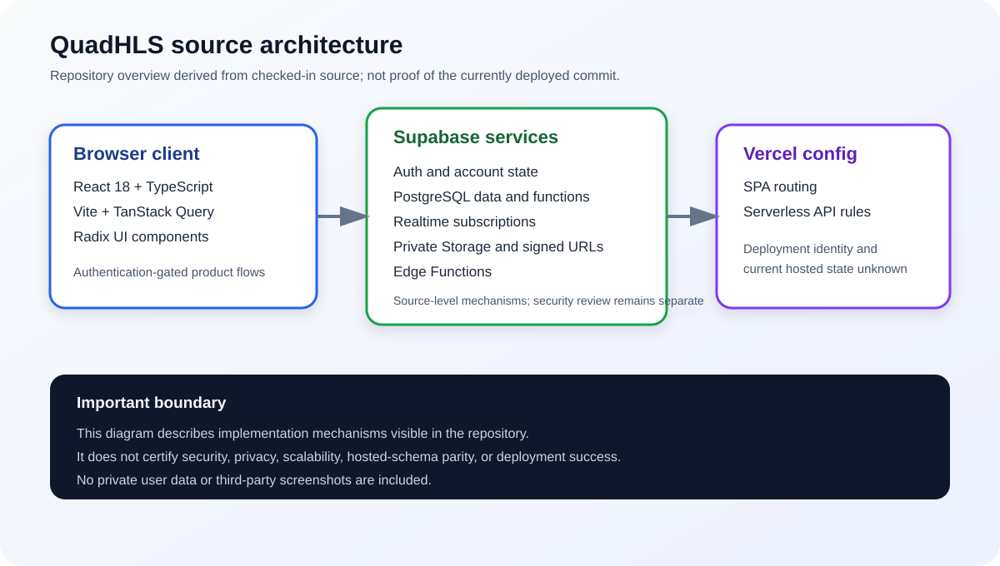

# QuadHLS

[Live site](https://www.quadhls.com) · [Justin Li on LinkedIn](https://www.linkedin.com/in/justinjunzeli)

QuadHLS is an independent, authentication-gated academic resource and community platform built for law students at Harvard. It is not owned, sponsored, commissioned, or endorsed by Harvard University or Harvard Law School.

**Observed status:** launched and online. The public site was reachable on July 17, 2026, and tracked document activity continued through July 13, 2026. The feature-development history in this repository culminated in a February 18, 2026 source snapshot; the exact deployed commit and the current maintenance or handoff arrangement have not been independently established.

## Verified Product Scale

- **716 registered accounts by November 23, 2025.** This is a dated registration count, not a claim about active, unique, or currently enrolled students.
- **7,903 indexed academic documents across 117 course labels.** The corpus contains 5,099 outlines and 2,804 exams. Partners acquired and organized legacy student-shared material, while the product also accepted new submissions; Justin integrated the corpus into the searchable catalog and preview/download workflows. This is a centralized corpus metric, not a user-upload count.
- **20,881 document preview/download interactions from 220 conservatively filtered users** between December 11, 2025, and July 13, 2026, after removing nine test/service accounts explicitly excluded in the application source.
- **5,367 course relationships across 750 completed profiles.** These are product onboarding relationships, not official school enrollment records.

The figures above come from dated aggregate production snapshots and code-defined filters. No private user-level data is published in this repository.

## Role and Collaboration

Justin Li served as **Co-Creator and Primary Engineer**, leading the large majority of the implementation across authentication, onboarding, resources, data modeling, feeds, integrations, performance work, and deployment. Collaborators contributed product and domain input plus limited technical work, including bounded messaging and calendar interface contributions. QuadHLS should not be represented as a solo project.

## Product Scope

The current source includes:

- Account authentication, onboarding, profiles, and a student directory
- Searchable outline and exam collections with PDF/DOCX preview and download workflows
- Course reviews, registration planning, and course-scoped context
- Campus and course feeds with posts, polls, comments, and reactions
- Bar-review resources, a Big Law guide, and the Quadle word game

Messaging, calendar integrations, and club spaces remain implemented and directly routable but were removed from primary navigation in January 2026. They should be treated as de-emphasized features rather than current flagship functionality. The authenticated phone experience is also not a complete supported mobile product.

## Architecture



The diagram is a source-derived recruiter overview. It describes implementation mechanisms visible in this repository and does not certify security, privacy, scalability, hosted-schema parity, or deployment success.

- **Client:** React 18, TypeScript, Vite, TanStack Query, and Radix UI
- **Backend:** Supabase Auth, PostgreSQL, Realtime, Storage, database functions/triggers, and Edge Functions
- **Deployment configuration:** Vercel SPA and serverless API configuration
- **Resource access:** private Storage buckets, signed URLs, Row Level Security policies, and feature-specific membership checks
- **Performance design:** lazy routes, manual chunking, paginated data access, selective query persistence, and deferred loading

These are specific implementation mechanisms, not a blanket security, privacy, reliability, or scalability certification.

## Source and Deployment Boundaries

- The live domain and continuing document activity are verified, but this repository does not prove which commit is currently deployed.
- The checked-in Vercel configuration is deployment configuration, not evidence of automated deployment from `main`.
- PWA support is conditional on `VITE_ENABLE_PWA=true`; its production state is unknown.
- The repository does not contain a canonical migration chain that can reproduce the current hosted Supabase schema.
- Authentication, storage authorization, and service-role API paths require dedicated security review before any production-readiness claim.
- No automated unit, integration, or end-to-end test suite is currently configured. The Vite build does not perform full TypeScript semantic checking.

## Local Setup

Use Node.js 20 or another runtime supported by the dependencies.

```bash
npm ci
```

Copy `.env.example` to `.env.local`, then provide a Supabase project URL and public anonymous key:

```dotenv
VITE_SUPABASE_URL=
VITE_SUPABASE_ANON_KEY=
```

Run the development server:

```bash
npm run dev
```

Create a production bundle:

```bash
npm run build
```

The bundle can be built without backend credentials, but functional authentication and data workflows require access to a compatible Supabase backend. Because the deployed database cannot be recreated from a complete migration history in this repository, local feature parity is not guaranteed.

## License and Contributions

This source is publicly visible for portfolio and evaluation purposes under the repository's proprietary [LICENSE](LICENSE). External contributions are not currently accepted. Any change to licensing or contribution policy requires agreement among the project owners.
